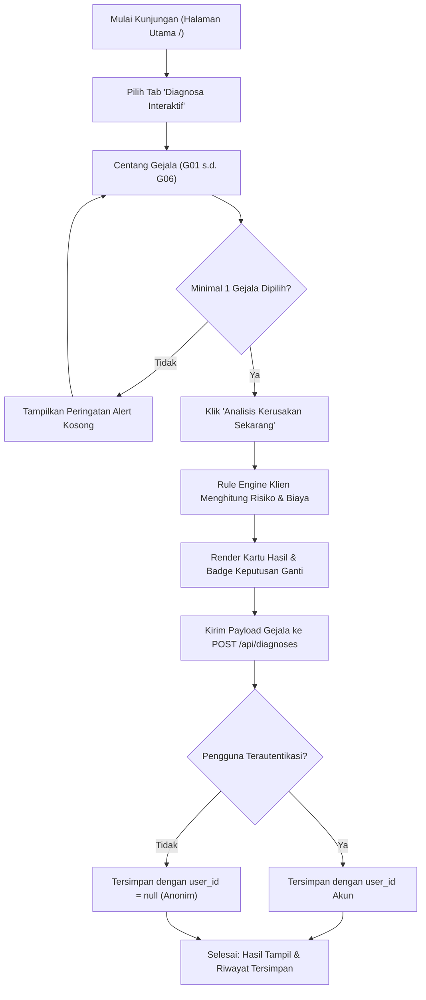
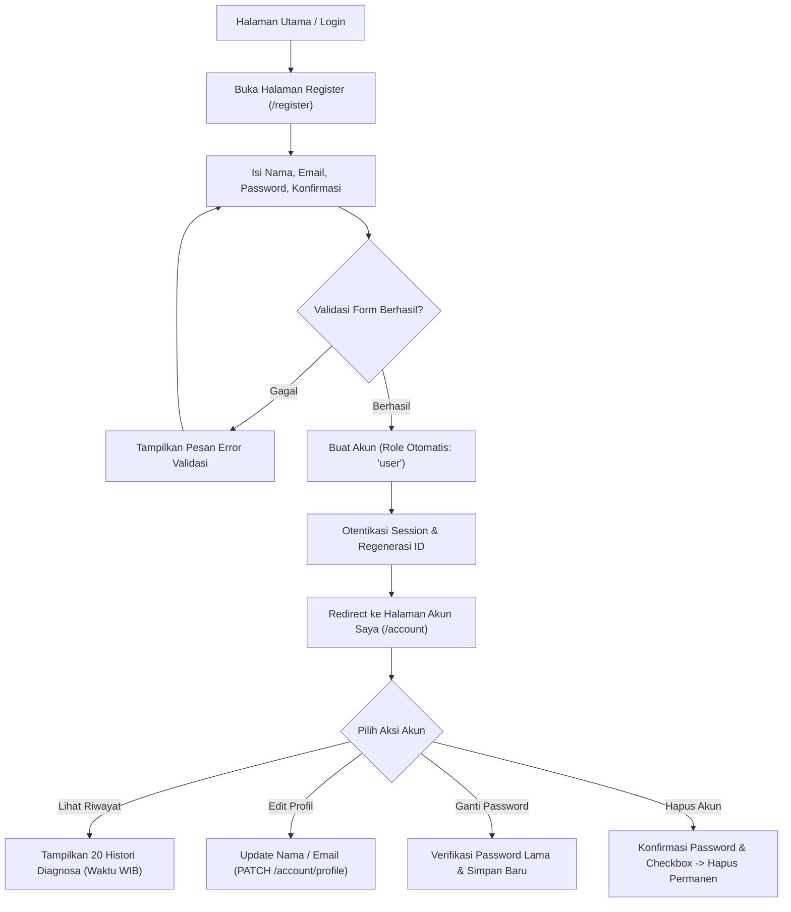
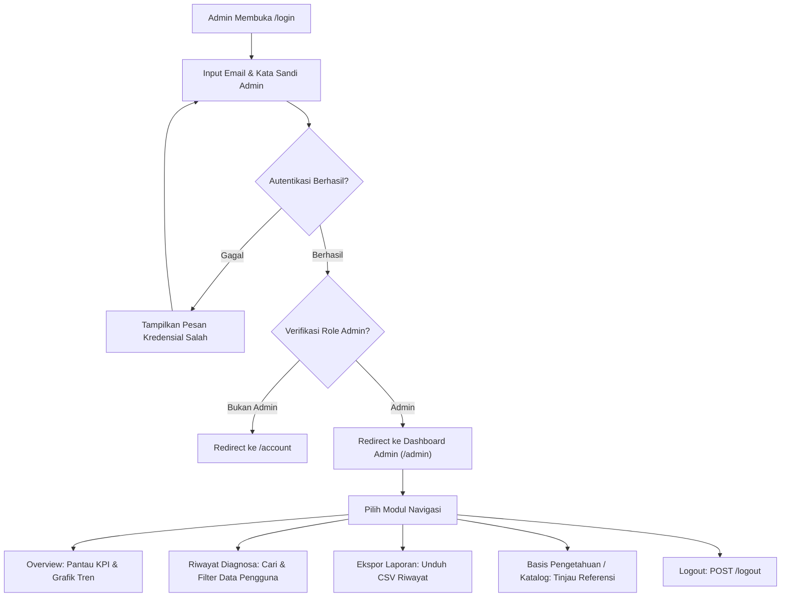
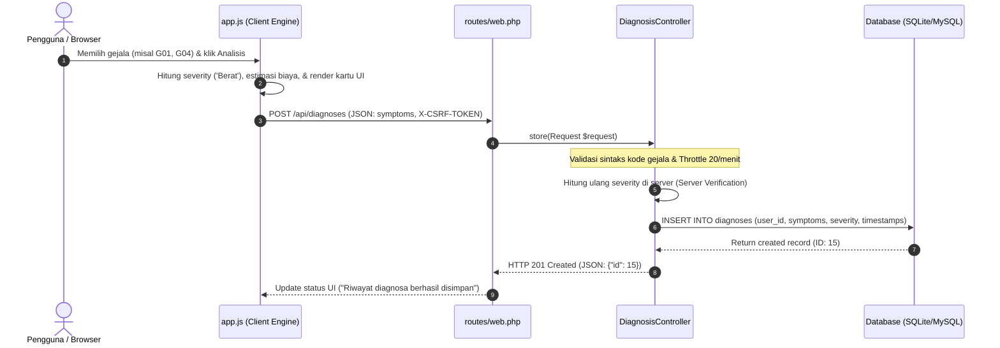
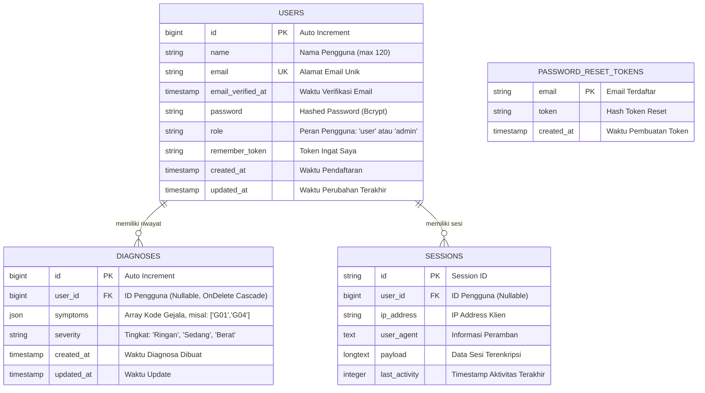

# Product Requirements Document (PRD) — MotoCheck

**Dokumen Spesifikasi Produk & Kebutuhan Sistem**  
*Sistem Pakar Diagnosa Kerusakan Sepeda Motor Berbasis Web*

---

## Daftar Isi

1. [Product Overview](#1-product-overview)
   - [1.1 Nama & Identitas Produk](#11-nama--identitas-produk)
   - [1.2 Deskripsi Produk](#12-deskripsi-produk)
   - [1.3 Latar Belakang Pengembangan](#13-latar-belakang-pengembangan)
   - [1.4 Permasalahan yang Diselesaikan (Problem Statement)](#14-permasalahan-yang-diselesaikan-problem-statement)
   - [1.5 Solusi yang Ditawarkan](#15-solusi-yang-ditawarkan)
   - [1.6 Tujuan Utama Aplikasi](#16-tujuan-utama-aplikasi)
   - [1.7 Target Pengguna](#17-target-pengguna)
2. [Product Goals & Objectives](#2-product-goals--objectives)
   - [2.1 Tujuan Produk](#21-tujuan-produk)
   - [2.2 Manfaat Produk](#22-manfaat-produk)
   - [2.3 Indikator Keberhasilan (Success Metrics / KPI)](#23-indikator-keberhasilan-success-metrics--kpi)
3. [User Personas](#3-user-personas)
   - [3.1 Persona 1: Pengunjung / Guest User](#31-persona-1-pengunjung--guest-user)
   - [3.2 Persona 2: Pengguna Terdaftar (Registered User)](#32-persona-2-pengguna-terdaftar-registered-user)
   - [3.3 Persona 3: Administrator Sistem](#33-persona-3-administrator-sistem)
   - [3.4 Matriks Hak Akses Pengguna](#34-matriks-hak-akses-pengguna)
4. [Functional Requirements](#4-functional-requirements)
   - [4.1 Modul A: Landing Page & Navigasi Publik](#41-modul-a-landing-page--navigasi-publik)
   - [4.2 Modul B: Autentikasi & Otorisasi Pengguna](#42-modul-b-autentikasi--otorisasi-pengguna)
   - [4.3 Modul C: Sistem Pakar Diagnosa Kerusakan Sepeda Motor](#43-modul-c-sistem-pakar-diagnosa-kerusakan-sepeda-motor)
   - [4.4 Modul D: Akun & Riwayat Diagnosa Pengguna](#44-modul-d-akun--riwayat-diagnosa-pengguna)
   - [4.5 Modul E: Admin Dashboard & Control Center](#45-modul-e-admin-dashboard--control-center)
   - [4.6 Modul F: Katalog Servis & Pemeriksaan Interval Odometer (KM Checker)](#46-modul-f-katalog-servis--pemeriksaan-interval-odometer-km-checker)
5. [Business Rules](#5-business-rules)
   - [5.1 Aturan Diagnosa & Inferensi Sistem Pakar](#51-aturan-diagnosa--inferensi-sistem-pakar)
   - [5.2 Aturan Penentuan Tingkat Keparahan (Severity Hierarchy)](#52-aturan-penentuan-tingkat-keparahan-severity-hierarchy)
   - [5.3 Aturan Keputusan Penggantian Suku Cadang](#53-aturan-keputusan-penggantian-suku-cadang)
   - [5.4 Aturan Penyimpanan & Kepemilikan Data Diagnosa](#54-aturan-penyimpanan--kepemilikan-data-diagnosa)
   - [5.5 Aturan Keamanan & Akses Akun](#55-aturan-keamanan--akses-akun)
6. [Knowledge Base (Basis Pengetahuan Kerusakan)](#6-knowledge-base-basis-pengetahuan-kerusakan)
   - [6.1 Daftar Entitas Kerusakan (G01 – G06)](#61-daftar-entitas-kerusakan-g01--g06)
   - [6.2 Tabel Pemetaan Komprehensif Basis Pengetahuan](#62-tabel-pemetaan-komprehensif-basis-pengetahuan)
7. [User Flow & Process Diagrams](#7-user-flow--process-diagrams)
   - [7.1 User Flow: Alur Pengunjung Melakukan Diagnosa](#71-user-flow-alur-pengunjung-melakukan-diagnosa)
   - [7.2 User Flow: Alur Registrasi & Pengelolaan Akun](#72-user-flow-alur-registrasi--pengelolaan-akun)
   - [7.3 User Flow: Alur Administrator Mengelola Sistem](#73-user-flow-alur-administrator-mengelola-sistem)
   - [7.4 Sequence Diagram: Diagnosa & Penyimpanan Riwayat](#74-sequence-diagram-diagnosa--penyimpanan-riwayat)
8. [Technical Requirements](#8-technical-requirements)
   - [8.1 Arsitektur Aplikasi](#81-arsitektur-aplikasi)
   - [8.2 Technology Stack](#82-technology-stack)
   - [8.3 Dependensi Paket (Package Dependencies)](#83-dependensi-paket-package-dependencies)
   - [8.4 Manajemen Aset Frontend](#84-manajemen-aset-frontend)
9. [Database Design & Schema](#9-database-design--schema)
   - [9.1 Entity Relationship Diagram (ERD)](#91-entity-relationship-diagram-erd)
   - [9.2 Spesifikasi Skema Tabel](#92-spesifikasi-skema-tabel)
10. [API & Routing Documentation](#10-api--routing-documentation)
    - [10.1 Daftar Rute Web (Web Routes)](#101-daftar-rute-web-web-routes)
    - [10.2 Dokumentasi Endpoint API Diagnosa](#102-dokumentasi-endpoint-api-diagnosa)
11. [UI/UX Requirements](#11-uiux-requirements)
    - [11.1 Desain Antarmuka Publik (Dark Theme)](#111-desain-antarmuka-publik-dark-theme)
    - [11.2 Desain Antarmuka Akun & Autentikasi](#112-desain-antarmuka-akun--autentikasi)
    - [11.3 Desain Antarmuka Admin Dashboard (Light Theme)](#113-desain-antarmuka-admin-dashboard-light-theme)
    - [11.4 Responsivitas & Aksesibilitas](#114-responsivitas--aksesibilitas)
12. [Non-Functional Requirements (NFR)](#12-non-functional-requirements-nfr)
13. [Security Requirements](#13-security-requirements)
    - [13.1 Mekanisme Keamanan yang Sudah Diimplementasikan](#131-mekanisme-keamanan-yang-sudah-diimplementasikan)
    - [13.2 Rekomendasi Peningkatan Keamanan](#132-rekomendasi-peningkatan-keamanan)
14. [Current Implementation Status](#14-current-implementation-status)
15. [Future Development & Roadmap](#15-future-development--roadmap)
    - [15.1 Prioritas Tinggi (High Priority)](#151-prioritas-tinggi-high-priority)
    - [15.2 Prioritas Menengah (Medium Priority)](#152-prioritas-menengah-medium-priority)
    - [15.3 Prioritas Rendah (Low Priority)](#153-prioritas-rendah-low-priority)
16. [Acceptance Criteria](#16-acceptance-criteria)
17. [Constraints & Assumptions](#17-constraints--assumptions)

---

## 1. Product Overview

### 1.1 Nama & Identitas Produk
- **Nama Produk:** MotoCheck
- **Tagline:** Sistem Pakar Diagnosa Kerusakan Sepeda Motor Berbasis Web
- **Slogan:** *Ketahui Kerusakan Motormu Sebelum Pergi ke Bengkel!*
- **Tipe Aplikasi:** Web-Based Single-Page Architecture (SPA-like client navigation) yang didukung oleh backend monolitik Laravel.

### 1.2 Deskripsi Produk
MotoCheck adalah platform sistem pakar (*expert system*) berbasis web yang dirancang khusus untuk memandu pemilik sepeda motor (khususnya motor matic 110cc–150cc) dalam mendeteksi dan mengidentifikasi potensi kerusakan teknis pada kendaraannya. Melalui kombinasi rule engine berbasis pengetahuan pakar otomotif pada sisi klien dan backend Laravel untuk persistensi data, pengguna dapat memilih gejala-gejala yang dirasakan pada sepeda motor dan secara instan menerima:
1. Indikasi komponen yang mengalami kerusakan.
2. Tingkat keparahan dan risiko operasional (*Ringan*, *Sedang*, *Berat/Kritis*).
3. Keputusan tegas mengenai penggantian suku cadang (**YA — WAJIB GANTI**, **TIDAK — BISA DISERVIS**, atau **KONDISIONAL — CEK DULU**).
4. Penjelasan akar masalah teknis dan solusi pertolongan pertama mandiri.
5. Estimasi rentang biaya suku cadang dan perbaikan.

### 1.3 Latar Belakang Pengembangan
Sepeda motor merupakan moda transportasi utama masyarakat di Indonesia. Namun, sebagian besar pengendara awam tidak memiliki pemahaman mekanis yang memadai mengenai sistem transmisi CVT, suplai bahan bakar injeksi, maupun siklus pelumasan mesin. Ketimpangan informasi (*information asymmetry*) antara pemilik kendaraan dan teknisi bengkel sering kali menimbulkan masalah:
- Pengguna mudah terpedaya untuk mengganti komponen yang sebenarnya masih dapat diservis.
- Munculnya biaya perbaikan yang melambung (*overcharging*).
- Keterlambatan penanganan pada kerusakan kritis (misalnya oli habis atau ring piston aus) yang mengakibatkan mesin rusak total (*jebol*).

MotoCheck hadir sebagai jembatan informasi teknis yang obyektif, transparan, dan dapat diakses secara gratis oleh siapa saja tanpa harus memiliki keahlian mekanik khusus.

### 1.4 Permasalahan yang Diselesaikan (Problem Statement)
| Masalah Pengendara | Dampak Riil | Solusi MotoCheck |
| :--- | :--- | :--- |
| **Buta Mekanis & Gejala Awal** | Kerusakan kecil diabaikan hingga merambat ke komponen vital mesin. | Menyediakan checklist gejala terstruktur dalam 3 kategori utama (Kelistrikan, Mesin, CVT). |
| **Overcharging & Manipulasi Bengkel** | Pengendara membayar biaya penggantian suku cadang yang sebetulnya tidak perlu diganti. | Memberikan transparansi status: apakah suku cadang wajib diganti atau cukup diservis terlebih dahulu. |
| **Ketidakpastian Biaya Servis** | Pengendara enggan ke bengkel karena takut tagihan melebihi anggaran. | Memberikan rentang estimasi biaya suku cadang realistis untuk motor harian 110–150cc. |
| **Lupa Jadwal Perawatan Rutin** | Komponen aus melampaui batas aman (busi mati, v-belt putus di jalan). | Fitur KM Checker interaktif dengan kalkulasi otomatis berdasarkan odometer motor. |

### 1.5 Solusi yang Ditawarkan
MotoCheck menghadirkan sistem pakar berbantuan komputer dengan fitur inferensi cepat (tanpa *page reload*) yang mengombinasikan:
- **Analisis Gejala Multi-Input:** Mampu mengevaluasi beberapa gejala sekaligus dan memprioritaskan tingkat risiko tertinggi.
- **Katalog Servis Berfilter:** Memudahkan pengecekan interval penggantian komponen seperti oli, busi, v-belt, kampas rem, dan filter udara.
- **Penyimpanan Riwayat Diagnosa:** Riwayat diagnosa dapat disimpan otomatis untuk memantau histori kesehatan motor pengendara.
- **Dashboard Analitik Administrator:** Memantau tren kerusakan sepeda motor terpopuler di kalangan masyarakat secara real-time.

### 1.6 Tujuan Utama Aplikasi
1. Memberikan alat bantu diagnosa mandiri yang akurat dan mudah dipahami oleh pengendara awam.
2. Meningkatkan literasi perawatan kendaraan bermotor roda dua di Indonesia.
3. Menyediakan histori diagnosa yang tersimpan rapi pada akun pengguna.
4. Menyediakan data analitik kerusakan kendaraan bagi pengelola bengkel atau administrator sistem.

### 1.7 Target Pengguna
- **Pemilik Sepeda Motor Harian:** Pengendara motor komuter (khususnya motor matic seperti Beat, Vario, Scoopy, NMAX, Aerox, PCX, Mio, dll.) yang membutuhkan verifikasi gejala sebelum ke bengkel.
- **Pemula / Pengendara Baru:** Pengendara yang belum memahami jadwal penggantian oli dan suku cadang berkala.
- **Administrator / Analis Data Bengkel:** Pengelola sistem yang memantau rekapitulasi data diagnosa dan tren kerusakan motor pengguna.

---

## 2. Product Goals & Objectives

### 2.1 Tujuan Produk
- **Akurasi Diagnosa:** Menghadirkan aturan inferensi sistem pakar deterministik yang mencakup 6 kelompok masalah utama sepeda motor.
- **Kemudahan Akses (Accessibility):** Pengunjung dapat langsung melakukan diagnosa tanpa diwajibkan login terlebih dahulu (*frictionless onboarding*).
- **Informatif & Aksi Nyata:** Memberikan rekomendasi pertolongan pertama dan estimasi biaya, bukan sekadar nama teknis kerusakan.

### 2.2 Manfaat Produk
- **Bagi Pengguna Umum:** Menghemat pengeluaran servis, menghindari penipuan bengkel, dan menjaga keawetan kendaraan.
- **Bagi Pengguna Terdaftar:** Memiliki riwayat kesehatan motor digital yang dapat diakses kapan saja dari peramban.
- **Bagi Administrator:** Memiliki gambaran statistik tentang komponen yang paling sering rusak dan tingkat utilisasi sistem.

### 2.3 Indikator Keberhasilan (Success Metrics / KPI)
- **Tingkat Partisipasi Diagnosa:** Jumlah diagnosa yang diselesaikan per sesi kunjungan pengguna.
- **Konversi Registrasi Pengguna:** Rasio pengunjung yang memutuskan membuat akun setelah melakukan diagnosa untuk menyimpan riwayat.
- **Kecepatan Inferensi:** Waktu eksekusi inferensi sistem pakar pada peramban kurang dari 100 milidetik.
- **Reliabilitas Endpoint:** Tingkat keberhasilan penyimpanan API `/api/diagnoses` di atas 99.5%.

---

## 3. User Personas

### 3.1 Persona 1: Pengunjung / Guest User
- **Profil:** Pengendara yang motornya mendadak bermasalah (misalnya tarikan brebet atau tidak bisa distarter) dan mencari solusi cepat melalui Google.
- **Karakteristik:** Menginginkan jawaban instan tanpa proses pendaftaran berbelit.
- **Kebutuhan:** Diagnosa gejala langsung, estimasi biaya, dan rekomendasi apakah motor aman dikendarai ke bengkel.
- **Hak Akses:**
  - Melihat Beranda (`/`).
  - Menjalankan Diagnosa Interaktif (`#tab-diagnosa`).
  - Mengakses Katalog Servis & KM Checker (`#tab-katalog`).
  - Data diagnosa disimpan secara anonim (`user_id = null`) ke server.
  - Mengakses halaman Login (`/login`) dan Registrasi (`/register`).

### 3.2 Persona 2: Pengguna Terdaftar (Registered User)
- **Profil:** Pengendara sepeda motor yang ingin mencatat riwayat kerusakan kendaraannya secara teratur.
- **Karakteristik:** Menginginkan akun pribadi untuk memantau riwayat diagnosa dan pengaturan profil.
- **Kebutuhan:** Riwayat diagnosa yang tersimpan dengan cap waktu lokal, kemampuan mengganti kata sandi, dan privasi akun.
- **Hak Akses:**
  - Seluruh hak akses Guest User.
  - Akses Halaman Akun Saya (`/account`).
  - Melihat maksimal 20 riwayat diagnosa terbaru miliknya.
  - Memperbarui nama dan email profil (`PATCH /account/profile`).
  - Mengganti kata sandi akun (`PUT /account/password`).
  - Menghapus akun dan riwayat secara mandiri (`DELETE /account`).
  - Logout (`POST /logout`).

### 3.3 Persona 3: Administrator Sistem
- **Profil:** Pengelola teknis platform MotoCheck atau staf bengkel mitra.
- **Karakteristik:** Memerlukan akses terpusat ke data agregat, metrik performa, dan rekapitulasi operasional.
- **Kebutuhan:** Melihat volume diagnosa, tren harian/bulanan, distribusi kerusakan, daftar pengguna, serta ekspor data ke format CSV.
- **Hak Akses:**
  - Akses Dashboard Admin (`/admin`).
  - Meninjau 4 metrik ringkasan (Total Diagnosa, Pengguna Terdaftar, Basis Pengetahuan, Diagnosa Hari Ini).
  - Melihat grafik tren 7 hari & 30 hari.
  - Memfilter dan mencari riwayat diagnosa dari seluruh pengguna.
  - Mengekspor data riwayat ke file CSV (`motocheck-riwayat-diagnosa.csv`).
  - Meninjau ringkasan basis pengetahuan dan katalog servis.
  - Dilarang mengakses halaman pengaturan pengguna reguler (`EnsureUserIsRegularUser`).

### 3.4 Matriks Hak Akses Pengguna

| Fitur / Halaman | Rute / Endpoint | Guest | User | Admin | Catatan Otorisasi |
| :--- | :--- | :---: | :---: | :---: | :--- |
| **Beranda & Diagnosa** | `GET /` | ✅ | ✅ | ✅ | Tombol navbar menyesuaikan status login. |
| **API Diagnosa** | `POST /api/diagnoses` | ✅ | ✅ | ✅ | Throttle 20 req/menit; menyimpan `user_id` jika login. |
| **Halaman Login** | `GET /login` | ✅ | ❌ | ❌ | Redirect otomatis jika sudah login. |
| **Proses Login** | `POST /login` | ✅ | ❌ | ❌ | Throttle 5 req/menit. |
| **Halaman Register** | `GET /register` | ✅ | ❌ | ❌ | Redirect otomatis jika sudah login. |
| **Proses Register** | `POST /register` | ✅ | ❌ | ❌ | Throttle 5 req/menit; role selalu dipaksa `'user'`. |
| **Logout** | `POST /logout` | ❌ | ✅ | ✅ | Memerlukan autentikasi session aktif. |
| **Akun Saya** | `GET /account` | ❌ | ✅ | ❌ | Admin diarahkan ke `/admin`. |
| **Update Profil** | `PATCH /account/profile` | ❌ | ✅ | ❌ | Middleware `regular-user`. |
| **Update Password** | `PUT /account/password` | ❌ | ✅ | ❌ | Middleware `regular-user`. |
| **Hapus Akun** | `DELETE /account` | ❌ | ✅ | ❌ | Middleware `regular-user`. |
| **Dashboard Admin** | `GET /admin` | ❌ | ❌ | ✅ | Middleware `admin` (`EnsureUserIsAdmin`). |

---

## 4. Functional Requirements

### 4.1 Modul A: Landing Page & Navigasi Publik
- **File Implementasi:** `routes/web.php`, `index.html`, `public/app.js`, `public/style.css`
- **Deskripsi:** Halaman publik utama yang menyajikan antarmuka single-page berbasis tab navigasi klien tanpa reload.
- **Kebutuhan Fungsional:**
  1. **Hero Section:** Menyajikan judul utama *"Ketahui Kerusakan Motormu Sebelum Pergi ke Bengkel!"*, subjudul pencegahan overcharging, dan dua tombol Call to Action (CTA): *"Mulai Diagnosa Sekarang"* (membuka tab Diagnosa) dan *"Cek Jadwal Servis"* (membuka tab Katalog).
  2. **Navigasi Tab:** Mendukung perpindahan instan antara 3 tab: `home`, `diagnosa`, dan `katalog` melalui fungsi JavaScript `switchTab(tabName)`. Navigasi juga merespons hash URL (misal `/#tab-diagnosa`).
  3. **Navigasi Dinamis Berdasarkan Akun:**
     - Jika belum login: Menampilkan tautan *"Masuk / Daftar"* menuju `/login`.
     - Jika user login: Menampilkan ikon profil menuju `/account` dan tombol *"Keluar"*.
     - Jika admin login: Menampilkan ikon profil menuju `/admin` dan tombol *"Keluar"*.
  4. **Responsivitas Menu Mobile:** Menu hamburger untuk perangkat mobile dengan fungsi `toggleMobileMenu()`.

### 4.2 Modul B: Autentikasi & Otorisasi Pengguna
- **File Implementasi:** `app/Http/Controllers/AuthController.php`, `resources/views/auth.blade.php`, `public/auth.css`
- **Kebutuhan Fungsional:**
  1. **Pendaftaran (Registration):**
     - Form input: Nama Lengkap (`max:120`), Email (`unique:users,email`), Kata Sandi (`min:10`), Konfirmasi Kata Sandi.
     - Proteksi Hak Akses: Server memaksa pengisian atribut `role = 'user'`. Masukan manipulatif `role` dari form diabaikan.
     - Auto-Login: Pengguna yang berhasil mendaftar langsung diautentikasi dan diarahkan ke `/account`.
  2. **Autentikasi Masuk (Login):**
     - Form input: Email, Kata Sandi, dan checkbox *"Ingat saya"* (*remember token*).
     - Validasi kredensial via `Auth::attempt`.
     - Regenerasi Session ID: Menghindari serangan *session fixation* melalui `$request->session()->regenerate()`.
     - Redirection Cerdas: Pengguna diarahkan ke `/admin` jika `role === 'admin'`, atau ke `/account` jika `role === 'user'`.
  3. **Keluar (Logout):**
     - Invalidation session dan regenerasi CSRF token melalui `POST /logout`.
     - Menampilkan pesan status flash pada halaman login.
  4. **Proteksi Rate Limiting:**
     - Rute `POST /login` dan `POST /register` dibatasi maksimal 5 percobaan per menit per IP (`throttle:5,1`).

### 4.3 Modul C: Sistem Pakar Diagnosa Kerusakan Sepeda Motor
- **File Implementasi:** `public/app.js`, `app/Http/Controllers/DiagnosisController.php`, `app/Models/Diagnosis.php`
- **Kebutuhan Fungsional:**
  1. **Checklist Gejala Terstruktur:** Gejala dikelompokkan ke dalam 3 kartu kategori:
     - **Kategori A (Kelistrikan & Starter):** Gejala `G01` (Aki/Baterai) dan `G02` (Sistem Pengisian/Kiprok/Spul).
     - **Kategori B (Mesin & Performa):** Gejala `G03` (Filter/Injektor Kotor), `G04` (Ring Piston Aus/Berasap), dan `G05` (Kurang Oli/Mesin Panas & Kasar - Kritis).
     - **Kategori C (Transmisi / CVT Matic):** Gejala `G06` (Decitan/Gredek CVT).
  2. **Validasi Pemilihan Gejala:** Menampilkan peringatan visual jika pengguna menekan tombol *"Analisis Kerusakan Sekarang"* tanpa memilih minimal satu gejala (`#alert-kosong`).
  3. **Kalkulasi & Hasil Inferensi Dinamis:**
     - Menampilkan jumlah kemungkinan kerusakan yang terdeteksi.
     - Menghitung akumulasi total rentang estimasi biaya perbaikan suku cadang secara otomatis dalam format mata uang Rupiah.
     - Menghitung status risiko keseluruhan sistem: **KRITIS** (jika terdapat gejala tingkat Berat), **SEDANG** (jika terdapat tingkat Sedang), atau **RINGAN** (jika hanya tingkat Ringan).
  4. **Penyajian Kartu Hasil Detail:**
     - Badge Tingkat Bahaya (*Ringan*, *Sedang*, *Berat*).
     - Badge Keputusan Penggantian Suku Cadang: **YA — WAJIB GANTI** (merah), **TIDAK — BISA DISERVIS** (hijau), **KONDISIONAL — CEK DULU** (amber).
     - Keterangan keputusan penggantian yang rasional.
     - Penjelasan akar masalah / penyebab utama.
     - Rekomendasi solusi & pertolongan pertama mandiri.
     - Estimasi biaya suku cadang per komponen.
  5. **Persistensi Asinkron ke Backend:**
     - Setelah tombol analisis diklik, JavaScript secara otomatis mengirimkan payload `{ symptoms: ["G01", ...] }` ke backend melalui `POST /api/diagnoses`.
     - Backend memvalidasi masukan, menghitung ulang tingkat keparahan (*server-side verification*), dan menyimpan record ke tabel `diagnoses`.
     - Jika pengguna sedang terotentikasi, record dihubungkan dengan `user_id`. Jika pengunjung anonim, `user_id` bernilai `null`.

### 4.4 Modul D: Akun & Riwayat Diagnosa Pengguna
- **File Implementasi:** `app/Http/Controllers/AccountController.php`, `app/Http/Controllers/AccountSettingsController.php`, `resources/views/account.blade.php`
- **Kebutuhan Fungsional:**
  1. **Tab Riwayat Diagnosa:**
     - Menampilkan maksimal 20 riwayat diagnosa terbaru pengguna yang diambil dari database.
     - Menampilkan daftar kode gejala, badge tingkat keparahan, dan format waktu lokal Indonesia (WIB, `Asia/Jakarta`).
     - State kosong (*empty state*): Menampilkan ajakan mulai diagnosa jika belum ada histori tersimpan.
  2. **Tab Pengaturan Akun:**
     - **Pembaruan Profil:** Form pengubahan nama (`max:120`) dan alamat email (`unique:users,email`). Jika email berubah, status verifikasi direset.
     - **Ganti Kata Sandi:** Form pengubahan kata sandi yang memvalidasi kata sandi saat ini (`current_password`), kata sandi baru (minimal 10 karakter), dan konfirmasi kata sandi baru.
     - **Hapus Akun Mandiri (*Self Account Deletion*):** Fitur proteksi tinggi yang mewajibkan konfirmasi kata sandi dan checkbox persetujuan. Menghapus akun dan seluruh riwayat diagnosa terkait secara permanen dalam satu transaksi database (`DB::transaction`).

### 4.5 Modul E: Admin Dashboard & Control Center
- **File Implementasi:** `app/Http/Controllers/AdminDashboardController.php`, `resources/views/admin-dashboard.blade.php`, `public/admin.js`, `public/admin.css`
- **Kebutuhan Fungsional:**
  1. **Ringkasan Metrik (Overview KPI):**
     - Total Diagnosa keseluruhan.
     - Jumlah Pengguna Terdaftar (role `user`).
     - Jumlah Basis Pengetahuan terdaftar (saat ini 6 item).
     - Total Diagnosa yang tercatat pada hari berjalan.
  2. **Visualisasi Grafik Tren Aktivitas:**
     - Grafik garis SVG interaktif yang menampilkan volume diagnosa per hari.
     - Pilihan rentang waktu: 7 hari terakhir atau 30 hari terakhir.
  3. **Analisis Diagnosa Teratas (Top Issues):**
     - Menampilkan 4 jenis kerusakan yang paling sering terdeteksi dari 100 riwayat diagnosa terbaru beserta persentase kontribusinya.
  4. **Tabel Riwayat Diagnosa Lengkap:**
     - Menampilkan daftar 100 diagnosa terbaru dengan rincian: Pengguna (Nama, Email, Avatar Inisial), Kerusakan, Kode Gejala, Tingkat Keparahan, Waktu Relatif (*diffForHumans* dalam Bahasa Indonesia), dan Status (*Selesai*).
     - Fitur pencarian teks instan (menyaring nama, email, diagnosis, dan kode gejala).
     - Filter tingkat keparahan (*Semua tingkat*, *Sedang*, *Ringan*, *Berat*).
  5. **Ekspor Laporan CSV:**
     - Fitur ekspor data riwayat terfilter ke format CSV (`motocheck-riwayat-diagnosa.csv`) lengkap dengan encoding UTF-8 BOM untuk kompatibilitas Microsoft Excel.
  6. **Pintasan Keyboard & UX:**
     - Pintasan `Cmd+K` atau `Ctrl+K` untuk langsung mengarahkan fokus ke kotak pencarian global.
     - Tombol `Escape` untuk menutup navigasi sidebar pada perangkat mobile.

### 4.6 Modul F: Katalog Servis & Pemeriksaan Interval Odometer (KM Checker)
- **File Implementasi:** `index.html`, `public/app.js`, `resources/views/welcome.blade.php`
- **Kebutuhan Fungsional:**
  1. **KM Checker (Pemeriksaan Status Servis):**
     - Input numerik jarak tempuh motor (kilometer) dengan tombol pintas (*quick preset buttons*): 2.500 KM, 8.000 KM, 10.000 KM, 15.000 KM, 20.000 KM, 25.000 KM.
     - Modal Popup Rekomendasi: Menganalisis sisa toleransi servis setiap suku cadang berdasarkan odometer dan menampilkan rekomendasi status (*Wajib Ganti*, *Jatuh Tempo*, atau *Pemeriksaan Rutin*).
  2. **Tabel Katalog Suku Cadang:**
     - Menyajikan 5 komponen standar motor matic: Oli Mesin, Busi Motor, V-Belt & Roller CVT, Kampas Rem Depan/Belakang, dan Filter Udara.
     - Menyertakan interval jarak/waktu, estimasi harga suku cadang, dan keterangan teknis.
  3. **Pencarian & Filter Real-Time:**
     - Kotak pencarian berbasis kata kunci instan.
     - Filter dropdown berdasarkan kategori: *Semua Kategori*, *Mesin & Pelumasan*, *Pengapian & Kelistrikan*, *Transmisi / CVT*, *Pengereman*, dan *Filter & Saluran Udara*.
     - Indikator jumlah item yang cocok dan tampilan kosong (*empty state*) jika pencarian tidak menemukan hasil.

---

## 5. Business Rules

### 5.1 Aturan Diagnosa & Inferensi Sistem Pakar
1. **Multi-Selection Gejala:** Pengguna diperbolehkan memilih antara 1 hingga 6 gejala sekaligus dalam satu sesi diagnosa.
2. **Minimal Masukan:** Pengguna tidak dapat menjalankan proses diagnosa jika tidak ada satupun gejala yang dipilih.
3. **Deterministik:** Setiap kode gejala (`G01` – `G06`) secara tunggal memetakan ke satu entitas kerusakan mekanis tertentu.
4. **Agregasi Biaya:** Estimasi biaya total dihitung dengan menjumlahkan batas bawah biaya minimum dan batas atas biaya maksimum dari seluruh gejala yang terpicu.

### 5.2 Aturan Penentuan Tingkat Keparahan (Severity Hierarchy)
Tingkat keparahan gabungan (*Overall Severity*) dihitung secara hierarkis, baik di sisi klien (`app.js`) maupun di sisi backend (`DiagnosisController.php`):
- **Tingkat Berat (Kritis):** Jika pilihan gejala mengandung minimal satu gejala berstatus **Berat** (`G04` atau `G05`).
- **Tingkat Sedang:** Jika pilihan gejala TIDAK mengandung gejala Berat, namun mengandung minimal satu gejala berstatus **Sedang** (`G01`, `G02`, atau `G03`).
- **Tingkat Ringan:** Jika pilihan gejala HANYA terdiri atas gejala berstatus **Ringan** (`G06`).

### 5.3 Aturan Keputusan Penggantian Suku Cadang
Sistem memberikan klasifikasi keputusan penggantian sparepart berdasarkan sifat kerusakan komponen:
1. **YA (Wajib Ganti):** Diberikan pada kerusakan komponen struktural mesin internal yang aus atau rusak fisik parah (`G04` Ring Piston/Sil Klep dan `G05` Piston/Stang Seher). Pengabaian dapat merusak blok silinder permanen atau menyebabkan mesin terkunci (*engine failure*).
2. **TIDAK (Bisa Diservis / Dibersihkan):** Diberikan pada masalah akibat kotoran, kerak, atau penyetelan kelistrikan (`G02` Pengisian/Spul/Kiprok, `G03` Filter/Injektor Kotor, dan `G06` CVT Gredek). Komponen tidak boleh langsung diganti sebelum dibersihkan dan diuji ulang.
3. **KONDISIONAL (Cek / Cas Terlebih Dahulu):** Diberikan pada komponen yang fungsinya menurun namun memiliki kemungkinan dipulihkan (`G01` Aki Lemah). Aki harus dites tegangan (< 12.4V) dan dicas ulang sebelum diputuskan ganti baru.

### 5.4 Aturan Penyimpanan & Kepemilikan Data Diagnosa
1. **Kepemilikan Pengguna:** Jika pengguna sedang login saat menekan tombol analisis, diagnosa disimpan dengan mengikat foreign key `user_id = auth()->user()->id`.
2. **Penyimpanan Anonim:** Jika dilakukan oleh pengunjung (tamu), diagnosa tetap disimpan ke database dengan `user_id = null`. Hal ini menjamin integritas data statistik admin tanpa melanggar privasi tamu.
3. **Limitasi Riwayat Pengguna:** Halaman akun pengguna dibatasi menampilkan 20 riwayat diagnosa terbaru untuk menjaga performa rendering dan kenyamanan antarmuka.

### 5.5 Aturan Keamanan & Akses Akun
1. **Pemisahan Role Ketat:**
   - Role pengguna hanya terdiri dari `'user'` dan `'admin'`.
   - Role `'admin'` hanya dapat dibuat melalui konsol server (`php artisan motocheck:make-admin` atau database seeder). Registrasi publik secara mutlak hanya menghasilkan role `'user'`.
   - Administrator tidak diizinkan mengakses halaman akun pengguna reguler (`/account`) dan akan dialihkan ke `/admin`.
   - Pengguna reguler dilarang mengakses `/admin` dan akan menerima respons HTTP `403 Forbidden`.
2. **Integritas Penghapusan Akun:** Penghapusan akun pengguna wajib menyertakan verifikasi kata sandi aktif dan centang konfirmasi. Seluruh riwayat diagnosa milik pengguna bersangkutan akan terhapus secara beruntun (*cascade delete*) dalam satu transaksi database.

---

## 6. Knowledge Base (Basis Pengetahuan Kerusakan)

### 6.1 Daftar Entitas Kerusakan (G01 – G06)
Basis pengetahuan sistem pakar MotoCheck dibangun dari 6 basis aturan representatif untuk sepeda motor 4-tak harian (khususnya matic):

```
[G01] Aki Drop / Lemah (Battery Failure)
[G02] Sistem Pengisian / Spul / Kiprok (Charging System Defect)
[G03] Filter Udara / Injektor / Karbu Kotor (Fuel & Air Mixture Issues)
[G04] Ring Piston Aus / Sil Klep Bocor (Oil Burning & Blow-by)
[G05] Kekurangan Oli / Piston & Stang Seher Oblak (Severe Engine Wear)
[G06] Kampas Ganda / Rumah CVT Kotor (Clutch Bell Glazing & Dust)
```

### 6.2 Tabel Pemetaan Komprehensif Basis Pengetahuan

| Kode | Gejala Fisik | Akar Masalah (Penyebab) | Solusi & Pertolongan Pertama | Tingkat | Keputusan Ganti | Rentang Biaya |
| :---: | :--- | :--- | :--- | :---: | :---: | :---: |
| **G01** | Starter elektrik mati / tombol starter tidak merespon sama sekali. | Tegangan aki di bawah standar (< 12.4V), sel sulfasi, atau usia pakai baterai telah habis (> 2 tahun). | Nyalakan mesin dengan kick starter (engkol), ukur voltase aki dengan multitester, bersihkan kerak terminal aki, cek pengisian. | **Sedang** | **KONDISIONAL**<br>*(Cas dulu, ganti jika voltase tetap drop < 12V)* | Rp 150.000 – Rp 250.000 |
| **G02** | Lampu depan redup atau klakson berbunyi kecil saat mesin langsam. | Arus listrik dari spul/kiprok tidak stabil saat langsam, soket regulator kendor/terbakar, atau kumparan spul gosong sebagian. | Ukur output kiprok dengan multitester (normal: 13.5V – 14.8V saat digas), bersihkan soket regulator dan terminal aki, periksa spul pengisian. | **Sedang** | **TIDAK**<br>*(Prioritaskan servis, cek soket kabel & spul terlebih dahulu)* | Rp 50.000 – Rp 200.000 |
| **G03** | Mesin ngempos, brebet, atau tarikan gas terasa berat / kosong. | Suplai udara/bensin terhambat debu pada elemen filter udara, nosel injektor tersumbat sulfur BBM, atau spuyer karburator kotor. | Buka dan periksa box filter udara (bersihkan/ganti jika tipe kering), servis infus injektor / semprot carb cleaner, gunakan BBM beroktan tepat. | **Sedang** | **TIDAK**<br>*(Bersihkan filter & injektor dulu, ganti jika filter fisik rusak)* | Rp 35.000 – Rp 90.000 |
| **G04** | Knalpot mengeluarkan asap putih/hitam pekat dan boros bensin. | Oli mesin naik ke ruang bakar akibat celah ring piston aus atau sil klep mengeras/retak; terjadi penurunan kompresi mesin. | Pantau stik oli agar tidak kehabisan oli. Segera jadwalkan pembongkaran blok silinder (korter/bore-up, ganti ring piston & sil klep orisinil). | **Berat** | **YA**<br>*(Wajib ganti ring piston/sil klep untuk hindari blok baret)* | Rp 200.000 – Rp 600.000+ |
| **G05** | Mesin cepat sekali panas dan terdengar suara ketukan kasar di area blok silinder. | Volume oli mesin menyusut drastis/kering total; friksi logam ekstrem tanpa pelumas memicu stang piston oblak dan piston membentur dinding silinder. | **Matikan mesin secepatnya & jangan dipaksa hidup!** Periksa volume oli lewat dipstick. Tambah oli darurat atau derek motor ke bengkel untuk cek kruk as & stang seher. | **Berat** | **YA**<br>*(Wajib overhaul total — ganti piston & stang seher. DARURAT)* | Rp 150.000 – Rp 800.000+ |
| **G06** | Terdengar suara berdecit atau getaran kasar (*gredek*) saat awal gas ditarik. | Penumpukan debu residu gesekan kampas ganda pada mangkok kopling CVT, permukaan mangkok licin (*glazing*), atau gemuk CVT mengering. | Servis CVT berkala: bongkar rumah kopling, bersihkan debu kompresor, amplas halus tapak kampas ganda, cuci mangkok CVT, lumasi grease CVT *high-temp*. | **Ringan** | **TIDAK**<br>*(Bersihkan & lumasi CVT dulu, ganti hanya jika kampas tipis)* | Rp 30.000 – Rp 60.000 |

---

## 7. User Flow & Process Diagrams

### 7.1 User Flow: Alur Pengunjung Melakukan Diagnosa



### 7.2 User Flow: Alur Registrasi & Pengelolaan Akun



### 7.3 User Flow: Alur Administrator Mengelola Sistem



### 7.4 Sequence Diagram: Diagnosa & Penyimpanan Riwayat



---

## 8. Technical Requirements

### 8.1 Arsitektur Aplikasi
MotoCheck menerapkan arsitektur **Monolith Modern Berbasis Laravel 11/12** yang memadukan antarmuka klien dinamis (*SPA-like reactive feel*) dengan backend RESTful internal:
- **Routing & Delivery:** Rute beranda `/` menyajikan antarmuka lengkap melalui pemuatan berkas statis `index.html` dengan injeksi token CSRF dan aksi navigasi akun dinamis secara aman.
- **Client-Side Engine:** Logika diagnosa, kalkulasi biaya, modal kilometer, dan filter katalog dieksekusi secara instan di peramban pengguna menggunakan Vanilla JavaScript ES6+ tanpa ketergantungan framework berat.
- **Server-Side Rendering (SSR) untuk Akun & Admin:** Modul autentikasi, manajemen akun, dan dashboard admin memanfaatkan Laravel Blade untuk keamanan maksimal dan kemudahan pengelolaan session.

### 8.2 Technology Stack

| Komponen | Teknologi yang Digunakan | Versi / Keterangan |
| :--- | :--- | :--- |
| **Backend Framework** | Laravel Framework | `^11.0` / `^12.0` (PHP Framework) |
| **Bahasa Pemrograman** | PHP | `^8.2` |
| **Database Engine** | SQLite (Default Dev) / MySQL | SQLite berkas lokal `database/database.sqlite` |
| **Frontend Styling** | Tailwind CSS & Custom CSS | Tailwind CDN + `public/style.css`, `public/auth.css`, `public/admin.css` |
| **Frontend Scripting** | Vanilla JavaScript | ES6+ Standard (`public/app.js`, `public/admin.js`) |
| **Font & Tipografi** | Google Fonts | *Inter* (Publik), *DM Sans* & *Manrope* (Auth & Admin) |
| **Testing Harness** | PHPUnit | `^11.5.3` |

### 8.3 Dependensi Paket (Package Dependencies)
Berdasarkan berkas `composer.json`:
- `php`: `^8.2`
- `laravel/framework`: `^12.0`
- `laravel/tinker`: `^2.10.1` (REPL CLI untuk manajemen server & pembuatan admin)
- **Dev Dependencies:** `phpunit/phpunit` (`^11.5.3`), `fakerphp/faker` (`^1.23`), `mockery/mockery` (`^1.6`), `nunomaduro/collision` (`^8.6`), `laravel/pint` (`^1.13`), `laravel/sail` (`^1.41`).

### 8.4 Manajemen Aset Frontend
Aplikasi tidak memerlukan build step yang rumit (Webpack/Vite compile step opsional):
- Seluruh aset publik tersimpan langsung pada direktori `public/` (`app.js`, `style.css`, `admin.js`, `admin.css`, `auth.css`).
- Perubahan pada styling atau script dapat langsung diuji di peramban tanpa keharusan menjalankan `npm run build`.

---

## 9. Database Design & Schema

### 9.1 Entity Relationship Diagram (ERD)



### 9.2 Spesifikasi Skema Tabel

#### 1. Tabel `users`
- **Fungsi:** Menyimpan data kredensial dan hak akses pengguna serta administrator.
- **Migration Source:** `0001_01_01_000000_create_users_table.php` & `2026_11_05_000001_add_role_to_users_table.php`
- **Struktur Kolom:**
  - `id` (BIGINT UNSIGNED, Primary Key, Auto Increment)
  - `name` (VARCHAR 255)
  - `email` (VARCHAR 255, Unique Index)
  - `email_verified_at` (TIMESTAMP, Nullable)
  - `password` (VARCHAR 255)
  - `role` (VARCHAR 255, Default `'user'`, Index): Membedakan role `'user'` dan `'admin'`.
  - `remember_token` (VARCHAR 100, Nullable)
  - `created_at` & `updated_at` (TIMESTAMP, Nullable)

#### 2. Tabel `diagnoses`
- **Fungsi:** Menyimpan seluruh transaksi diagnosa yang dilakukan pengunjung maupun pengguna terdaftar.
- **Migration Source:** `2026_11_05_000002_create_diagnoses_table.php`
- **Struktur Kolom:**
  - `id` (BIGINT UNSIGNED, Primary Key, Auto Increment)
  - `user_id` (BIGINT UNSIGNED, Nullable, Foreign Key referencing `users(id)` ON DELETE SET NULL / CASCADE programmatically via transaction).
  - `symptoms` (JSON): Menyimpan array kode gejala (contoh: `["G01", "G06"]`).
  - `severity` (VARCHAR 20, Index): Nilai `'Ringan'`, `'Sedang'`, atau `'Berat'`.
  - `created_at` (TIMESTAMP, Index) & `updated_at` (TIMESTAMP, Nullable).

#### 3. Tabel Pendukung Framework
- `sessions`: Manajemen session berbasis database (jika `SESSION_DRIVER=database`).
- `password_reset_tokens`: Tabel token reset kata sandi Laravel standar.
- `cache` & `cache_locks`: Penyimpanan cache jika `CACHE_STORE=database`.
- `jobs`, `job_batches`, & `failed_jobs`: Pengelolaan antrean tugas latar belakang (*queue*).

---

## 10. API & Routing Documentation

### 10.1 Daftar Rute Web (Web Routes)
Seluruh rute didefinisikan pada `routes/web.php`:

| HTTP Method | URL Path | Controller / Action | Middleware | Deskripsi Fungsi | Hak Akses |
| :---: | :--- | :--- | :--- | :--- | :--- |
| `GET` | `/` | Closure (Stream `index.html`) | `web` | Menampilkan antarmuka publik MotoCheck dengan injeksi auth buttons dinamis. | Publik |
| `GET` | `/login` | `AuthController@showLogin` | `web`, `guest` | Menampilkan formulir masuk akun. | Tamu (Guest) |
| `POST` | `/login` | `AuthController@login` | `web`, `guest`, `throttle:5,1` | Memproses autentikasi masuk. | Tamu (Guest) |
| `GET` | `/register` | `AuthController@showRegistration` | `web`, `guest` | Menampilkan formulir pendaftaran akun baru. | Tamu (Guest) |
| `POST` | `/register` | `AuthController@register` | `web`, `guest`, `throttle:5,1` | Menyimpan pendaftaran pengguna baru (role `user`). | Tamu (Guest) |
| `POST` | `/logout` | `AuthController@logout` | `web`, `auth` | Mengakhiri sesi pengguna & regenerasi token. | User / Admin |
| `POST` | `/api/diagnoses` | `DiagnosisController@store` | `web`, `throttle:20,1` | Menyimpan data diagnosa ke database. | Publik / User |
| `GET` | `/account` | `AccountController` | `web`, `auth` | Menampilkan riwayat diagnosa & menu pengaturan user. | User Reguler |
| `PATCH` | `/account/profile` | `AccountSettingsController@updateProfile` | `web`, `auth`, `regular-user` | Memperbarui nama dan alamat email profil. | User Reguler |
| `PUT` | `/account/password` | `AccountSettingsController@updatePassword` | `web`, `auth`, `regular-user` | Mengubah kata sandi akun pengguna. | User Reguler |
| `DELETE` | `/account` | `AccountSettingsController@destroy` | `web`, `auth`, `regular-user` | Menghapus akun dan riwayat diagnosa secara permanen. | User Reguler |
| `GET` | `/admin` | `AdminDashboardController` | `web`, `auth`, `admin` | Menampilkan dashboard analitik dan kontrol admin. | Administrator |

### 10.2 Dokumentasi Endpoint API Diagnosa

#### `POST /api/diagnoses`
Menyimpan riwayat gejala hasil diagnosa pengguna atau pengunjung.

- **Headers:**
  - `Accept: application/json`
  - `Content-Type: application/json`
  - `X-CSRF-TOKEN: <csrf_token>`
- **Request Body (JSON):**
  ```json
  {
    "symptoms": ["G01", "G04"]
  }
  ```
- **Aturan Validasi Server:**
  - `symptoms`: Wajib ada (`required`), bertipe array, minimal 1 elemen (`min:1`), maksimal 6 elemen (`max:6`).
  - `symptoms.*`: Wajib bertipe string, nilainya harus unik (*distinct*), dan nilainya harus terdapat dalam daftar `['G01', 'G02', 'G03', 'G04', 'G05', 'G06']`.
- **Response Success (HTTP 201 Created):**
  ```json
  {
    "id": 14
  }
  ```
- **Response Error Validasi (HTTP 422 Unprocessable Content):**
  ```json
  {
    "message": "The symptoms.0 field is invalid.",
    "errors": {
      "symptoms.0": ["The selected symptoms.0 is invalid."]
    }
  }
  ```
- **Rate Limit Response (HTTP 429 Too Many Requests):** Diterapkan jika request melebihi 20 panggilan per menit per IP.

---

## 11. UI/UX Requirements

### 11.1 Desain Antarmuka Publik (Dark Theme)
- **Nuansa & Tema:** *Modern Dark Theme* yang elegan dengan latar belakang slate gelap (`#0f172a` / `bg-slate-900` dan `#1e293b` / `bg-slate-800`).
- **Aksen Warna Utama (Brand Accent):** Oranye menyala (`#f97316` / `rgb(249, 115, 22)`) yang melambangkan nuansa otomotif, keberanian, dan peringatan teknis.
- **Tipografi:** Menggunakan font keluarga **Inter** (Google Fonts) dengan penegasan hirarki ukuran font yang jelas (`text-base` untuk gejala, `text-xl` untuk nama kerusakan, `text-2xl`–`text-4xl` untuk judul utama).
- **Komponen Visual:**
  - Kartu dengan sudut membulat modern (`rounded-2xl`, `rounded-3xl`).
  - Checkbox custom dengan indikator centang putih saat dipilih.
  - Efek transisi halus (*hover effects*, scale micro-interactions, dan animasi fade-in).

### 11.2 Desain Antarmuka Akun & Autentikasi
- **Nuansa & Tema:** *Clean Soft Minimalist* dengan kontras tinggi (`#f6f7f9` canvas, putih untuk card, aksen oranye).
- **Tipografi:** Kombinasi **DM Sans** untuk teks isi dan **Manrope** untuk judul utama.
- **Pengalaman Pengguna (UX):**
  - Tab navigasi interaktif berbasis atribut aksesibilitas ARIA (`role="tablist"`, `aria-selected`, `role="tabpanel"`).
  - Navigasi keyboard pada tab menggunakan panah kanan/kiri (`ArrowRight`/`ArrowLeft`), `Home`, dan `End`.
  - Alert error dan feedback sukses yang jelas dengan warna semantik hijau (sukses) dan merah (error).

### 11.3 Desain Antarmuka Admin Dashboard (Light Theme)
- **Nuansa & Tema:** *Professional SaaS Control Center* dengan palet warna abu-abu netral, garis pemisah halus (`#eceef2`), dan sidebar gelap (`#20232b`).
- **Keterbacaan Teks:** Menggunakan ukuran font proporsional (teks tabel 13px, header kolom 11.5px, judul 26px, angka metrik 27px) untuk memudahkan pemantauan harian.
- **Interaksi:**
  - Filter tabel real-time tanpa refresh halaman.
  - Responsive toggle sidebar untuk layar tablet dan ponsel pintar.
  - Pemberitahuan *toast* otomatis saat ekspor CSV berhasil.

### 11.4 Responsivitas & Aksesibilitas
- Mendukung tampilan optimal pada layar ponsel pintar (360px+), tablet, laptop, hingga monitor desktop ultra-lebar (1920px+).
- Komponen formulir dilengkapi atribut aksesibilitas (`aria-label`, `for` pada label, dan `aria-expanded`).

---

## 12. Non-Functional Requirements (NFR)

| Kategori | Parameter Kebutuhan | Standar / Target Implementasi |
| :--- | :--- | :--- |
| **Performance** | Waktu inferensi sistem pakar | < 50 ms pada peramban klien (*pure JavaScript*). |
| **Performance** | Waktu muat halaman (Page Load) | < 1.5 detik pada koneksi internet standar (3G/4G). |
| **Performance** | Overhead API Simpan Diagnosa | Waktu respons API `POST /api/diagnoses` < 150 ms. |
| **Reliability** | Ketersediaan Sistem | Waktu aktif sistem (*uptime*) ditargetkan minimal 99.8%. |
| **Security** | Proteksi Serangan Brute-Force | Rate limiting 5 req/menit pada rute login dan register. |
| **Security** | Enkripsi Sandi | Algoritma *Bcrypt* dengan minimal 10 karakter kata sandi. |
| **Data Integrity** | Konsistensi Penghapusan Akun | Transaksi ACID (`DB::transaction`) saat menghapus akun dan diagnosa. |
| **Usability** | Kemudahan Pengoperasian | Pengguna dapat memperoleh hasil diagnosa maksimal dalam 3 klik. |
| **Maintainability** | Keterbacaan Kode | Penulisan kode terstruktur, modular, dan mengikuti PSR-12. |

---

## 13. Security Requirements

### 13.1 Mekanisme Keamanan yang Sudah Diimplementasikan
1. **CSRF Protection (Cross-Site Request Forgery):**
   - Seluruh form Blade dan panggilan `fetch()` asinkron pada `app.js` memverifikasi token CSRF via header `X-CSRF-TOKEN`.
2. **Role-Based Access Control (RBAC):**
   - Middleware `EnsureUserIsAdmin` menghentikan akses ke `/admin` bagi pengguna non-admin dengan status `403 Forbidden`.
   - Middleware `EnsureUserIsRegularUser` mengalihkan admin yang mencoba mengakses `/account` ke `/admin`.
3. **Pencegahan Eskalasi Hak Akses (Privilege Escalation):**
   - Pengontrol `AuthController::register` secara eksplisit menetapkan `role => 'user'`, mengabaikan injeksi nilai `role` dari form registrasi.
4. **Rate Limiting (Pencegahan DoS & Brute Force):**
   - `/login`: 5 request / menit.
   - `/register`: 5 request / menit.
   - `/api/diagnoses`: 20 request / menit.
5. **Sanitasi Output & Anti-XSS:**
   - Seluruh rendering data dinamis pada `admin.js` melewati fungsi sanitasi khusus `escapeHtml()`.
   - Blade engine menggunakan sintaks `{{ $var }}` yang otomatis mengeksekusi `htmlspecialchars()`.
6. **Validasi Masukan Server-Side:**
   - Validasi ketat pada `DiagnosisController` yang hanya menerima kode gejala sah (`G01` – `G06`).
   - Validasi `current_password` pada saat pembaruan kata sandi maupun penghapusan akun.

### 13.2 Rekomendasi Peningkatan Keamanan
1. **Dukungan Verifikasi Email Aktif:** Mengaktifkan antarmuka pengiriman email verifikasi saat registrasi atau perubahan alamat email.
2. **Dukungan Reset Kata Sandi via Email:** Mengimplementasikan form lupa kata sandi (*forgot password*) dengan token reset.
3. **Content Security Policy (CSP):** Menambahkan HTTP header CSP pada middleware untuk membatasi eksekusi skrip dari sumber eksternal yang tidak dikenal.

---

## 14. Current Implementation Status

Berikut adalah status implementasi fitur berdasarkan audit mendalam terhadap seluruh source code MotoCheck:

| Modul / Fitur | Status | Bukti Implementasi (Source Code) | Catatan & Temuan Teknis |
| :--- | :---: | :--- | :--- |
| **Landing Page & Tab Switcher** | **Implemented** | `routes/web.php` L11-45, `index.html`, `public/app.js` L124-186 | Berjalan penuh. Pindah tab via hash & JavaScript tanpa reload. |
| **Checklist Gejala (G01–G06)** | **Implemented** | `index.html` L200-380, `public/app.js` L9-118 | Form lengkap terbagi dalam 3 kategori (Kelistrikan, Mesin, CVT). |
| **Rule Engine Klien** | **Implemented** | `public/app.js` L233-300 | Menghitung tingkat keparahan, estimasi total, dan memicu tampilan hasil. |
| **Badge Keputusan Penggantian** | **Implemented** | `public/app.js` L198-230, L338-353 | Status YA / TIDAK / KONDISIONAL tampil jelas dengan warna semantik. |
| **KM Checker (Odometer Modal)** | **Implemented** | `public/app.js` L439-559, `index.html` | Modal popup kalkulasi interval servis berfungsi dengan preset KM. |
| **Katalog Sparepart & Filter** | **Implemented** | `index.html` L530-760, `public/app.js` L566-608 | Tabel lengkap dengan pencarian real-time dan dropdown kategori. |
| **API Penyimpanan Diagnosa** | **Implemented** | `app/Http/Controllers/DiagnosisController.php` | Validasi server-side, throttle 20/menit, mendukung tamu dan user. |
| **Registrasi Pengguna** | **Implemented** | `app/Http/Controllers/AuthController.php` L51-70 | Memaksa role 'user', auto-login, throttle 5/menit. |
| **Login & Remember Me** | **Implemented** | `app/Http/Controllers/AuthController.php` L24-40 | Regenerasi sesi, redirection cerdas berdasarkan role. |
| **Logout Sesi** | **Implemented** | `app/Http/Controllers/AuthController.php` L72-79 | Invalidation session & regenerate CSRF token. |
| **Riwayat Diagnosa Pengguna** | **Implemented** | `resources/views/account.blade.php` L36-47 | Tampil 20 riwayat terbaru dengan konversi waktu lokal WIB (`Asia/Jakarta`). |
| **Update Profil & Ganti Password**| **Implemented** | `app/Http/Controllers/AccountSettingsController.php` | Menggunakan form request validation bag, verifikasi kata sandi lama. |
| **Penghapusan Akun Mandiri** | **Implemented** | `app/Http/Controllers/AccountSettingsController.php` L43-63 | Menghapus akun dan riwayat via transaksi database atomic. |
| **Admin KPI & Metrik** | **Implemented** | `app/Http/Controllers/AdminDashboardController.php` | Menghitung total diagnosa, pengguna terdaftar, dan tren hari ini. |
| **Admin Grafik Tren Aktivitas** | **Implemented** | `AdminDashboardController.php`, `public/admin.js` L79-94 | Visualisasi garis SVG interaktif untuk rentang 7 & 30 hari. |
| **Admin Top Diagnosa** | **Implemented** | `AdminDashboardController.php`, `public/admin.js` L65-77 | Proporsi 4 kerusakan teratas dihitung dari 100 data terbaru. |
| **Admin Filter & Pencarian Tabel**| **Implemented** | `public/admin.js` L44-63 | Penyaringan instan berdasarkan teks dan level keparahan. |
| **Admin Ekspor Laporan CSV** | **Implemented** | `public/admin.js` L118-136 | Ekspor data tabel ke berkas CSV dengan UTF-8 BOM. |
| **Manajemen CRUD Basis Pengetahuan**| **Planned / Mock** | `resources/views/admin-dashboard.blade.php` L151-154 | Masih bertanda `HANYA TAMPILAN`. Data gejala masih hardcoded di kode program. |
| **Manajemen CRUD Katalog Admin**| **Planned / Mock** | `resources/views/admin-dashboard.blade.php` L156-166 | Tampilan ringkasan statis, belum ada form tambah/edit sparepart dari admin. |
| **Reset Password via Email** | **Planned** | Belum ada rute di `routes/web.php` | Pengguna yang lupa sandi belum bisa mereset secara mandiri via email. |

---

## 15. Future Development & Roadmap

Berdasarkan analisis kesenjangan (*gap analysis*) terhadap kode sumber MotoCheck saat ini, berikut rekomendasi peta jalan pengembangan berikutnya:

```mermaid
flowchart LR
    subgraph F1["Fase 1 (High Priority)"]
        A1["CRUD Basis Pengetahuan Admin"]
        A2["CRUD Katalog Sparepart Admin"]
        A3["Fitur Lupa Sandi via Email"]
    end

    subgraph F2["Fase 2 (Medium Priority)"]
        B1["Ekstensifikasi Gejala (G07 - G15)"]
        B2["Integrasi Certainty Factor"]
        B3["Profil Garasi Motor Pengguna"]
    end

    subgraph F3["Fase 3 (Low Priority)"]
        C1["Integrasi Bengkel Mitra"]
        C2["Estimasi Biaya Multi-Wilayah"]
        C3["Progressive Web App (PWA)"]
    end

    F1 --> F2 --> F3
```



### 15.1 Prioritas Tinggi (High Priority)
1. **CRUD Dinamis Basis Pengetahuan (`knowledge_base`):**
   - *Masalah:* Saat ini daftar gejala hardcoded pada `app.js` dan `DiagnosisController.php`. Menu admin bertanda "HANYA TAMPILAN".
   - *Solusi:* Buat tabel migrasi `knowledge_base` dan controller admin untuk menambah, mengubah, atau menonaktifkan kode gejala tanpa menyentuh source code.
2. **CRUD Katalog Suku Cadang (`spareparts`):**
   - *Masalah:* Data katalog suku cadang di halaman depan masih ditulis langsung dalam HTML/JS.
   - *Solusi:* Buat tabel database `spareparts` agar admin dapat memperbarui rentang harga pasar berkala.
3. **Fitur Lupa Kata Sandi (*Password Reset*):**
   - *Masalah:* Belum tersedia alur reset kata sandi jika pengguna reguler lupa kredensialnya.
   - *Solusi:* Implementasikan rute standar Laravel `password.request` dan `password.reset`.

### 15.2 Prioritas Menengah (Medium Priority)
1. **Ekstensifikasi Gejala Sistem Pakar (G07 – G15):**
   - Menambah cakupan kerusakan: sistem pengereman hidrolis (minyak rem blong), sistem suspensi bocor, lahar roda (*bearing* goyang), sensor injeksi (TPS/O2 sensor), dan transmisi manual/bebek (kampas kopling selip).
2. **Penerapan Metode Ketidakpastian (Certainty Factor / Forward Chaining):**
   - Menambahkan bobot keyakinan pengguna (misal: *Sangat Yakin*, *Cukup Yakin*, *Ragu-Ragu*) untuk menghasilkan persentase kepastian diagnosa yang lebih presisi.
3. **Profil Sepeda Motor Pengguna (*Vehicle Garage Profile*):**
   - Mengizinkan pengguna menyimpan data motor spesifiknya (Merek, Tahun, Tipe Motor, Odometer saat ini) di profil akun.

### 15.3 Prioritas Rendah (Low Priority)
1. **Integrasi Bengkel Mitra & Lokasi:** Menampilkan rekomendasi bengkel terdekat yang memiliki reputasi transparan berdasarkan lokasi GPS pengguna.
2. **Progressive Web App (PWA):** Menjadikan MotoCheck dapat diinstal di homescreen ponsel pintar dan dapat melakukan diagnosa darurat secara *offline*.

---

## 16. Acceptance Criteria

Berikut adalah kriteria penerimaan untuk pengujian penerimaan pengguna (*User Acceptance Testing*):

### AC-01: Alur Diagnosa Interaktif Klien
- **Given:** Pengguna membuka tab Diagnosa Interaktif pada beranda.
- **When:** Pengguna memilih gejala `G04` (Knalpot berasap) dan `G01` (Aki drop), lalu menekan tombol *"Analisis Kerusakan Sekarang"*.
- **Then:**
  - Muncul section hasil diagnosa secara halus (*smooth scroll*).
  - Terdeteksi 2 kemungkinan kerusakan.
  - Akumulasi biaya menampilkan rentang `Rp 350.000 - Rp 850.000+`.
  - Tingkat risiko keseluruhan berstatus `KRITIS` karena adanya `G04`.
  - Kartu `G04` menampilkan badge `YA — WAJIB GANTI`.
  - Kartu `G01` menampilkan badge `KONDISIONAL — CEK DULU`.
  - Request `POST /api/diagnoses` menghasilkan HTTP 201.

### AC-02: Pencegahan Diagnosa Kosong
- **Given:** Pengguna belum mencentang kotak gejala apapun.
- **When:** Pengguna menekan tombol *"Analisis Kerusakan Sekarang"*.
- **Then:**
  - Section hasil tetap tersembunyi.
  - Tampil elemen `#alert-kosong` dengan teks *"Belum ada gejala yang dipilih!"*.
  - Layar bergeser ke arah alert peringatan.

### AC-03: Registrasi & Penegakan Role Pengguna
- **Given:** Calon pengguna mengisi form registrasi di `/register`.
- **When:** Pengguna mengirimkan form dengan data valid (nama, email unik, password 10 karakter).
- **Then:**
  - Akun baru tersimpan di database dengan kolom `role = 'user'`.
  - Pengguna langsung login otomatis dan diarahkan ke `/account`.
  - Pengguna tidak dapat mengakses `/admin` (HTTP 403 Forbidden).

### AC-04: Isolasi Akses Dashboard Admin
- **Given:** Pengguna terdaftar dengan role `'user'` sedang login.
- **When:** Pengguna mencoba membuka URL `http://127.0.0.1:8000/admin`.
- **Then:**
  - Sistem menolak akses dengan respons HTTP `403 Forbidden` dan pesan *"Akses hanya tersedia untuk administrator."*.

### AC-05: Filter & Ekspor CSV Admin
- **Given:** Administrator membuka menu Riwayat Diagnosa pada `/admin`.
- **When:** Admin mengetikkan nama pengguna tertentu di input pencarian dan menekan *"Ekspor laporan"*.
- **Then:**
  - Tabel menyaring baris secara instan sesuai kata kunci.
  - Berkas `motocheck-riwayat-diagnosa.csv` terunduh otomatis berisi data yang sedang terfilter.
  - Notifikasi toast *"Laporan diagnosa terbaru berhasil diekspor sebagai CSV."* tampil di sudut kanan bawah.

---

## 17. Constraints & Assumptions

### 17.1 Batasan Sistem (Constraints)
1. **Spesifikasi Tipe Kendaraan:** Basis pengetahuan saat ini dioptimalkan untuk sepeda motor matic 4-tak 110–150cc (sistem CVT dan injeksi umum di Indonesia). Motor kopling manual atau motor listrik belum tercakup secara mendalam.
2. **Karakteristik Biaya:** Estimasi biaya merupakan harga acuan rata-rata suku cadang orisinil/aftermarket berkualitas standar dan ongkos jasa di pulau Jawa. Variasi harga luar daerah dapat terjadi.
3. **Penyimpanan Sesi:** Secara default menggunakan driver session file / sqlite. Pada deployment produksi multi-server, diperlukan redis atau database session driver.
4. **Basis Pengetahuan Hardcoded:** Pengubahan aturan pakar saat ini memerlukan modifikasi berkas script `public/app.js` dan backend `DiagnosisController.php` hingga modul CRUD admin diimplementasikan.

### 17.2 Asumsi Pengembangan (Assumptions)
1. Pengguna memiliki pemahaman dasar terhadap gejala fisik motor yang dirasakan (suara kasar, asap knalpot, atau getaran).
2. Peramban pengguna mendukung JavaScript modern (ES6+) dan fitur Web Storage / Session Cookies.
3. Koneksi internet aktif tersedia saat pengguna ingin menyimpan hasil diagnosa ke server, meskipun proses inferensi itu sendiri dapat berjalan offline pada memori peramban.

---

*Dokumen PRD ini disusun dan diverifikasi secara komprehensif berdasarkan analisis aktual seluruh kode sumber, konfigurasi basis data, logika bisnis, dan dependensi proyek MotoCheck.*
